

# 💊 Sajilo Pharmacy

### Run your whole pharmacy from one window.

**Billing • Medicines & batches • Expiry tracking • Khata • Purchases • Reports**

Built for pharmacies in Nepal. **Works 100% offline** — no internet, no monthly fees.

 

### ⬇️ [**Download for Windows**](https://github.com/4anand20244-ux/pharmacy/releases/latest)

Windows 10 / 11 · 64-bit · 30-day free trial · One-time payment, lifetime license

 

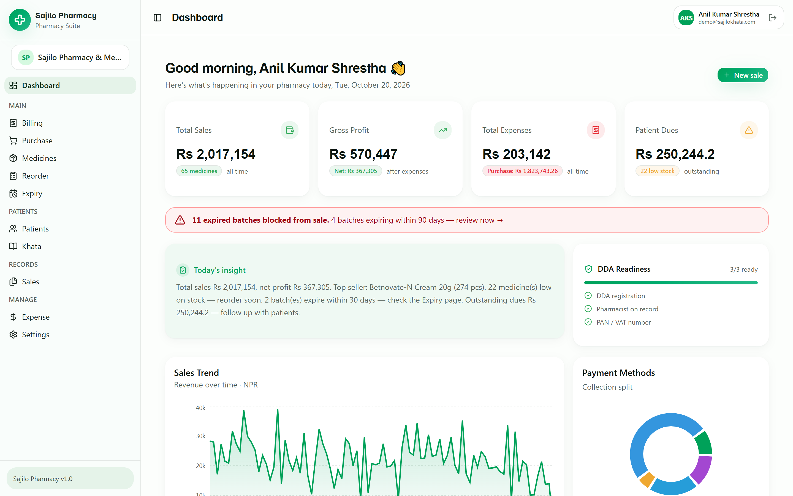

---

## Why pharmacy owners choose Sajilo Pharmacy

| | |
|---|---|
| ⚡ **Bill in seconds** | Search by generic, brand or manufacturer. Keyboard-first POS: `↑ ↓` to choose, `Enter` to add, `Ctrl+Enter` to complete the sale. |
| 🚫 **Expired medicine can't be sold** | Batches are tracked automatically. Expired stock is blocked at billing, and near-expiry stock is flagged before it becomes a loss. |
| 🕒 **FEFO by default** | Sales always take the earliest-expiring batch first, so old stock moves out before it expires. |
| 📒 **Digital khata** | Track patient credit, part-payments and outstanding dues — with one-tap WhatsApp reminders and aging lists. |
| 🧾 **DDA-ready invoices** | Thermal receipts (58 mm / 80 mm) with DDA registration, pharmacist name/registration and PAN. |
| 📶 **No internet needed** | Everything runs on your computer. No cloud, no login server, no downtime when the line is down. |
| 🔒 **Your data stays yours** | The database never leaves the shop. Download a backup to a pen drive whenever you want. |
| 💰 **One-time payment** | No subscription. No per-bill charges. Use it for years on the same PC. |

---

## Everything in one app

### 🧾 Billing (POS)
Search a medicine and see its **batch, expiry, stock and Rx status** before adding it. Add a patient, apply a discount, take payment by **Cash, QR or Khata**, then print or share the receipt.

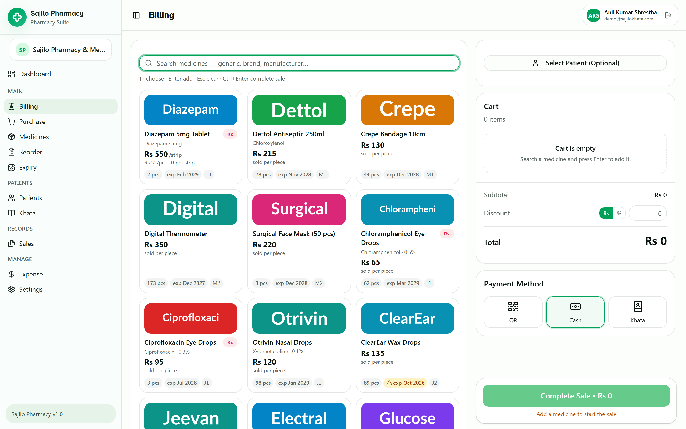

### 💊 Medicines & stock
A proper medicine master: generic name, brand, strength, dosage form, pack size, manufacturer, rack location, OTC/Rx schedule and narcotic flag. Stock shows in **strips + pieces** with low-stock warnings.

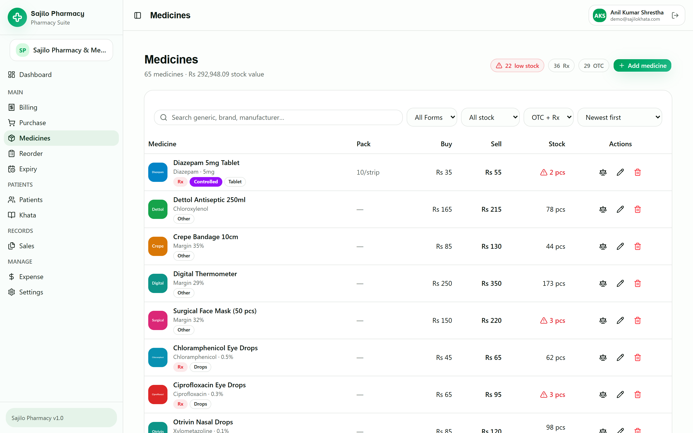

### 🗓️ Expiry & batch tracking
Know exactly what is expiring in the next 30 / 90 / 180 days and what is already expired — with quantity and value. Add batches as they arrive and quarantine expired ones in one click.

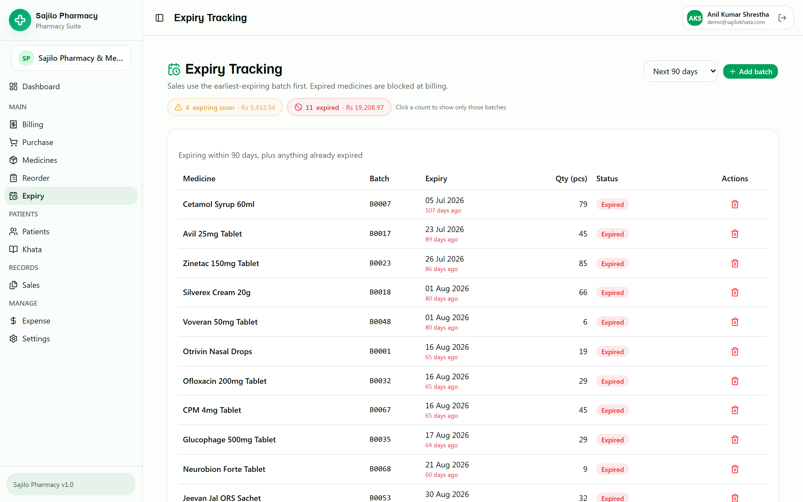

### 📒 Khata (patient credit)
The whole shop's outstanding dues in one place: who owes what, last payment, last credit, and **"no payment for the longest"** so you know who to follow up with first.

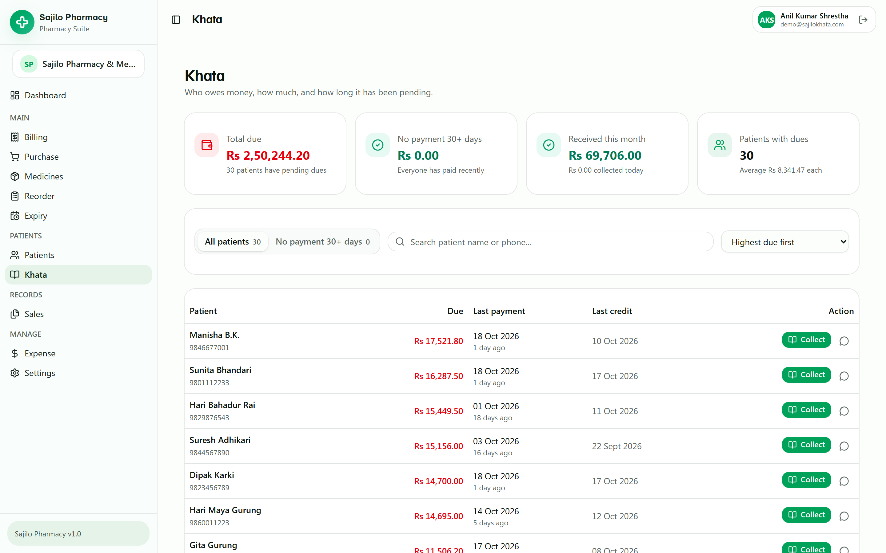

### 🧑‍🤝‍🧑 Patients & prescriptions
Every patient's purchase history, khata and prescription checks in one profile. A prescription can be attached to a sale when required.

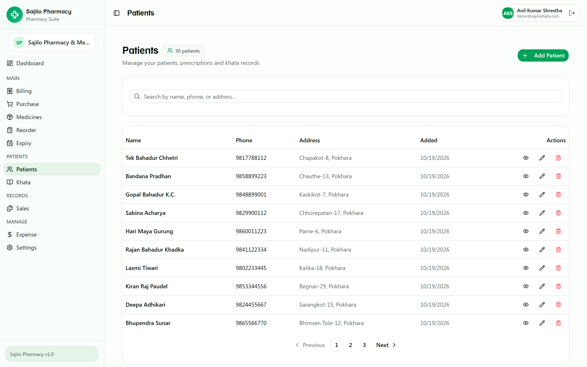

### 🛒 Purchases & suppliers
Record supplier bills with batch numbers, manufacturing/expiry dates and **free quantities** (e.g. 10+1 offers), then track payments to the supplier.

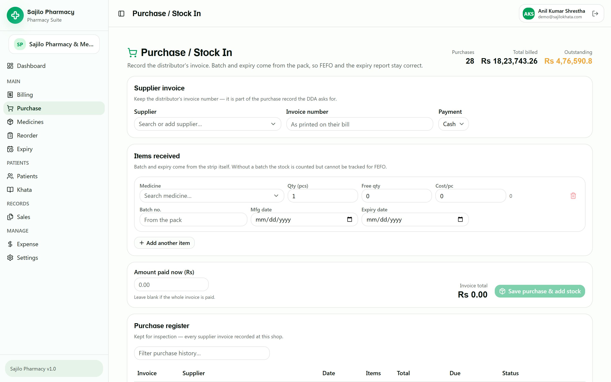

### 📊 Sales & receipts
Every bill with items, batch/expiry snapshots and payment method. Reprint a receipt or send it on WhatsApp at any time.

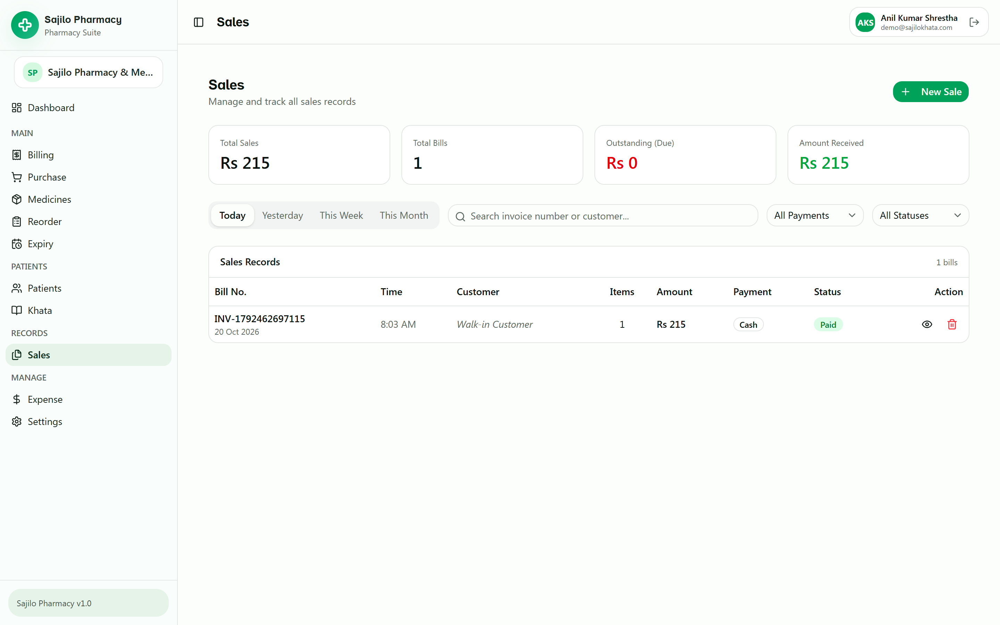

### 💸 Expenses
Record rent, salary, electricity and other shop expenses — they are included in the profit calculation automatically.

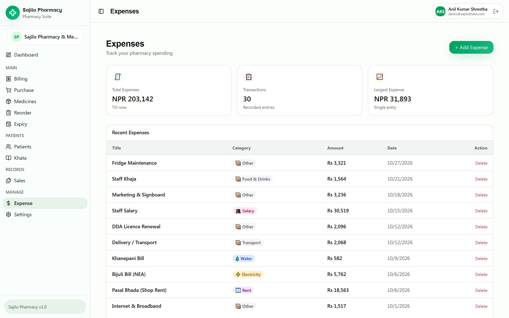

### 📈 Dashboard & reports
Today's sales, gross profit, expenses and patient dues at a glance, plus a sales trend, payment-method split and a daily business insight.

### ⚙️ Settings, printing & backup
Shop details and invoice header, receipt width (58 / 80 mm), thermal printer selection with silent printing, and one-click **backup / restore**.

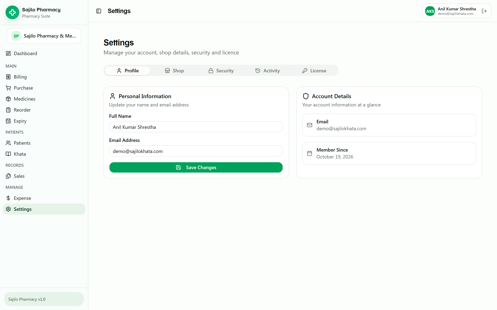

---

## Install in 2 minutes

1. **[Download the installer](https://github.com/4anand20244-ux/pharmacy/releases/latest)** — `Sajilo Pharmacy Setup 1.0.0.exe`.
2. Run it. If Windows SmartScreen appears, click **More info → Run anyway** (the installer is new and not code-signed yet).
3. Open **Sajilo Pharmacy** from the desktop, register your pharmacy and start billing.
4. Your **30-day free trial** starts on first launch. After that, activate with a lifetime license key.

### System requirements

| | |
|---|---|
| OS | Windows 10 or Windows 11 (64-bit) |
| Memory | 4 GB RAM or more |
| Disk | ~300 MB free |
| Internet | **Not required** after download |
| Printer | Any Windows printer — optimized for 58 mm / 80 mm thermal |

---

## Try it before you buy

No signup, no card, no internet. Install it, use every feature free for **30 days**, and activate only if it saves you time.

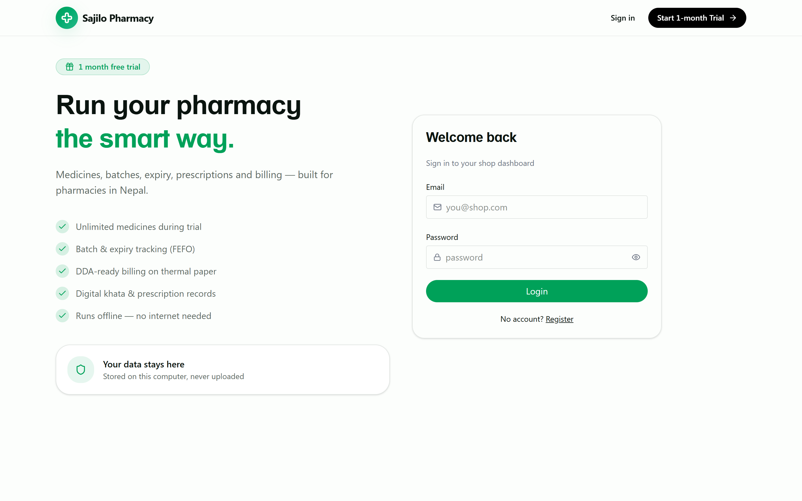

---

## Pricing & license

- **30-day free trial** — every feature, no signup, no internet.
- **One-time payment · lifetime license** — no subscription, no renewal.
- Each license is **locked to one computer** (Machine ID). Reinstalling on the same PC keeps working.
- Want to run it on a second PC? Just ask for an additional key.
- **Contact for current pricing** → [@anandkishorgupta](https://github.com/anandkishorgupta) or open an issue.

---

## FAQ

<b>Does it really work without internet?</b>

Yes. The app runs a private local server on your PC; no data is sent anywhere. You only need internet to download the installer.

<b>Where is my data stored?</b>

In `%APPDATA%\Sajilo Pharmacy\data` on your computer. Use **Settings → Backup** to download a copy, and **Restore** to bring it back.

<b>How do I activate my license?</b>

Open **Settings → License**, copy the Machine ID and send it to the seller. You will receive a key for that computer — paste it and the app becomes lifetime-activated.

<b>Can I print receipts?</b>

Yes. Choose your 58 mm or 80 mm thermal printer in Settings. If you have no printer, every bill can be shared on WhatsApp instead.

<b>Is the source code in this repository?</b>

No. This repository contains the installer, screenshots and documentation only. The source code is proprietary.

---

### Sajilo Pharmacy
**Simple billing. Smarter stock. Peace of mind.**

Made with ❤️ in Nepal 🇳🇵

